# Mini OPR: demo guide

A walkthrough for presenting Mini OPR: what a One Patient Record is, what this demo proves, the scenarios to run live, and how the team built it with agent skills and AI agents in one morning.

Every name, Patient and value in the demo is fictional. Terms in **bold** come from the glossary in [CONTEXT.md](../CONTEXT.md).

---

## 1. What is OPR?

**OPR = One Patient Record.** One patient, one record, no matter how many ambulance units and devices touch it.

In a real emergency a patient is often handled by more than one ambulance: one unit picks them up, another takes over for the long drive, a third may meet them at a hospital. Each unit works on its own tablet. Without a shared record, each tablet holds its own piece of the story, and the next crew starts from what someone tells them out loud.

An OPR means:

- every unit sees the same Patient,
- every change from every tablet is kept, nothing is overwritten by accident,
- a unit that takes over sees the whole history at once,
- a short loss of network does not lose any entry.

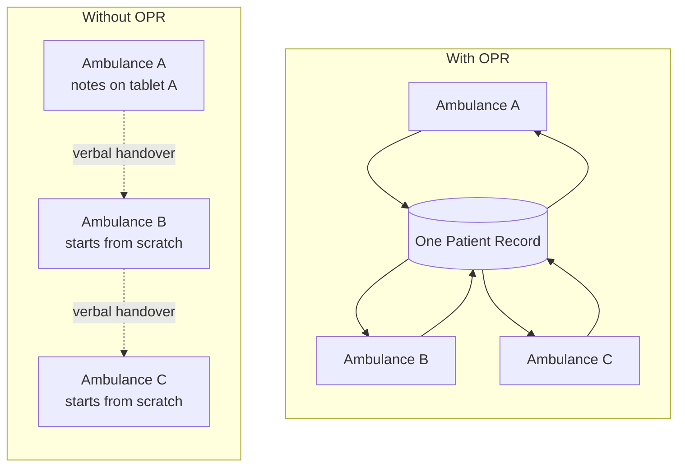

## 2. What Mini OPR solves

Mini OPR is a **demo, not a product**. It uses no product code, no real data and no real integrations. It exists to show, on one laptop, how an OPR should behave when one Patient travels across several **Transfer legs**, each handled by a different **Resource** on its own **Device**.

The hard questions it answers:

| Question | Mini OPR's answer |
|---|---|
| Where does the truth live? | Each Device writes its own **Event log**. One **Coordinator** gathers every Event log. The Patient is rebuilt from the events. |
| Two Devices edit the same field. Who wins? | The newest edit wins, field by field. Vitals and notes are never overwritten, every entry is kept. |
| The network drops for a moment. | The Device saves every change on itself first and sends it in the background. After reconnect it resends from where the Coordinator stopped (the **Offset**). |
| A new ambulance takes over. | It **Joins** the Incident by its id and gets the full history at once. No accept step. The earlier Resource can still edit. |
| When is the case over? | An **Incident** is Closed while it has no **Active leg**. A Join reopens it. |

### The pieces

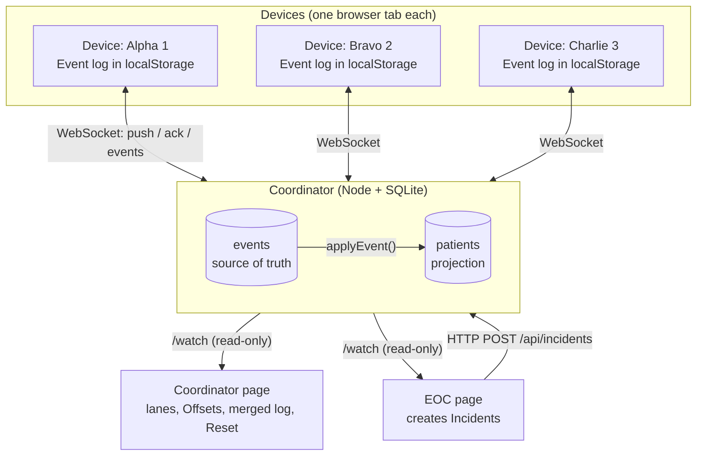

- **EOC** creates an Incident and the first Transfer leg. It changes nothing after that.
- **Device** is one Resource in one browser tab. It edits the Patient, Joins Incidents, completes its own leg.
- **Coordinator** stores every event, rebuilds the Patient with the same reducer the Device uses, and pushes new events to every Device of the Incident in realtime.

### The domain in one picture

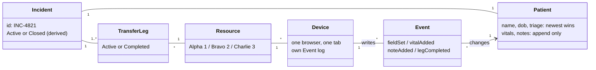

### Lifecycle of a leg and an Incident

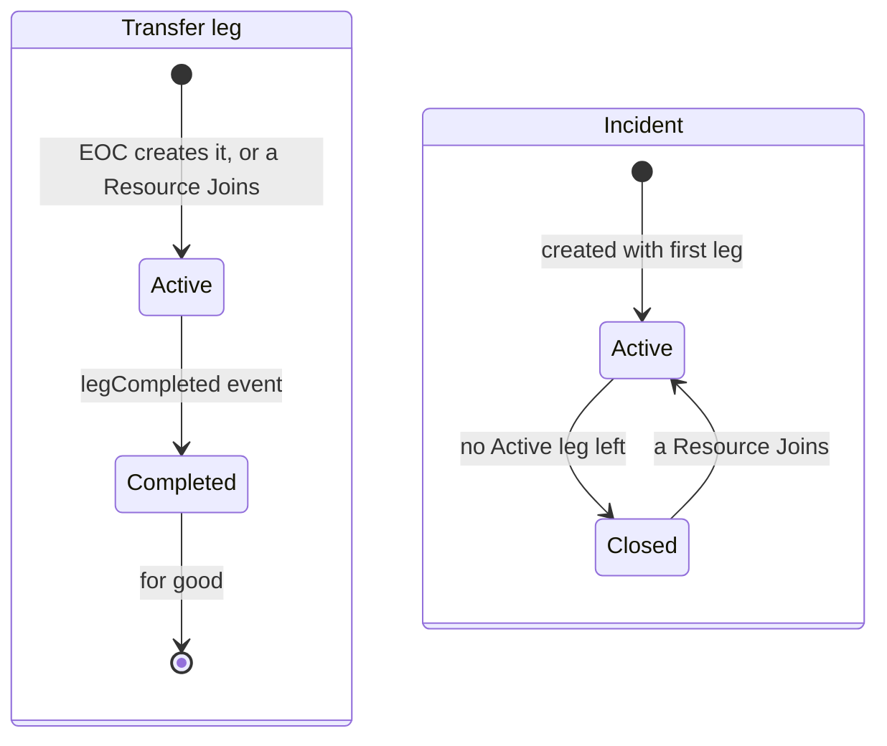

### How sync works

Each Device numbers its own events (`seq` 1, 2, 3...). The Coordinator remembers, per Device, how far it has stored without gaps: the **Offset**. Upload is "everything above my Offset"; download is a full snapshot after each connect, then realtime pushes.

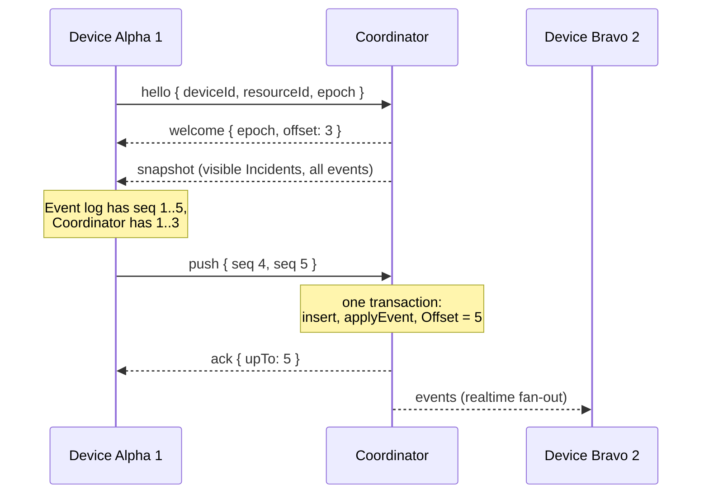

### Who wins when two Devices edit

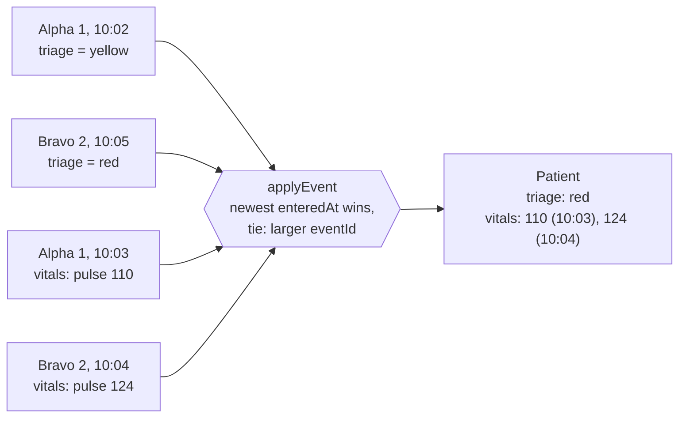

The result is the same in any arrival order. That claim is checked with property tests that fold every permutation of a set of events.

---

## 3. Demo scenarios

Setup: `npm install`, then `npm run dev`, then open http://localhost:5173. The start page opens the EOC page, three Device tabs (Alpha 1, Bravo 2, Charlie 3) and the Coordinator page. Lay them out side by side.

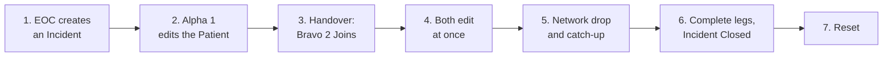

### Scenario 1: EOC creates an Incident

1. On the EOC page, fill name, date of birth and triage (all optional), pick **Alpha 1** for the first leg, create.
2. A new row appears with a short id such as `INC-4821` and a copy button.
3. The Alpha 1 Device shows the Incident at once. The Patient details from the EOC show in its feed as normal events from the EOC.
4. On the Coordinator page, the EOC lane shows those events.

**Point to make:** the EOC is not a Device. It has no Event log; the Coordinator records its details as events so they follow the same rules as Device edits.

### Scenario 2: Alpha 1 works on the Patient

1. On Alpha 1, add vitals, add a note, change triage.
2. Switch to "My Event log": each event has its `seq` and is stored.
3. On the Coordinator page, Alpha 1's lane grows and its Offset line moves.
4. The EOC table updates live with the new triage.

**Point to make:** the Device writes locally first, then syncs. The Offset is how far the Coordinator has stored without gaps.

### Scenario 3: Handover, Bravo 2 Joins

1. Copy the Incident id from the EOC page.
2. On Bravo 2, open **Resource**, paste the id, Join.
3. Bravo 2 gets the whole history at once: EOC details, Alpha 1's vitals and notes.

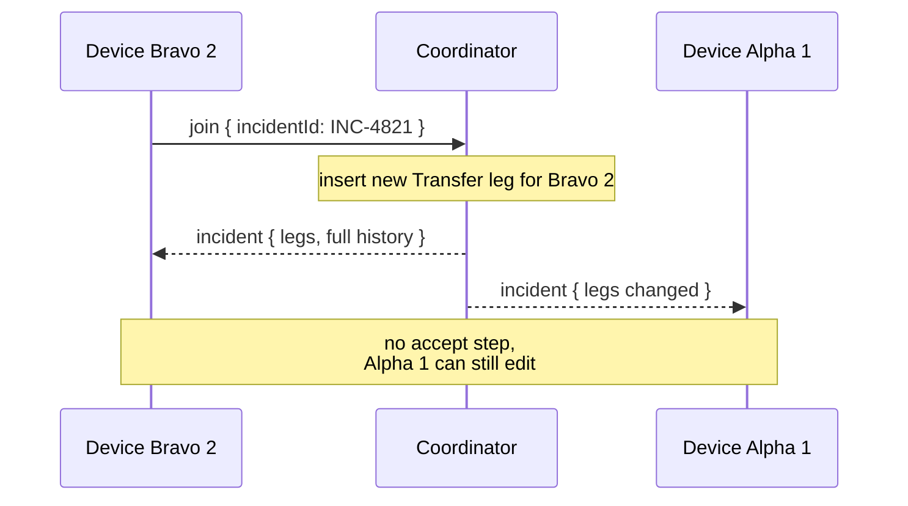

**Point to make:** no accept step, and the earlier Resource keeps edit rights.

### Scenario 4: Both edit at the same time

1. On Alpha 1 set triage to yellow; right after, on Bravo 2 set triage to red.
2. Both add vitals.
3. Both Devices show triage **red** (newest wins) and **both** vitals entries, in the same order.

**Point to make:** no conflict dialog, no lost entries, same result on every Device.

### Scenario 5: Short network drop

1. Stop the Coordinator process (Ctrl+C on the terminal, or kill the coordinator part of `npm run dev`).
2. Every Device shows **offline**. Keep editing on Alpha 1: the new events show as waiting in "My Event log".
3. Start the Coordinator again. Devices reconnect by themselves (backoff 0.5, 1, 2, 4, then at most 5 s).
4. Waiting events are sent from the Offset, stored, and fanned out to Bravo 2.

**Point to make:** nothing is lost, nothing is sent twice. A plain restart keeps the **Coordinator epoch**, so Devices keep their data.

### Scenario 6: Complete legs, Incident Closed, Join reopens

1. On Alpha 1, "Complete my leg" (with a confirm, it cannot be undone). The feed shows a system line.
2. Alpha 1 can still edit: the Incident is still Active because Bravo 2's leg is Active.
3. On Bravo 2, complete its leg. The Incident becomes **Closed**; both composers lock.
4. On Charlie 3, Join the same id. The Incident reopens.

### Scenario 7: Reset

1. On the Coordinator page, Reset (with a confirm).
2. A new epoch appears. Every Device disconnects, sees the new epoch on reconnect and clears itself. EOC and Coordinator pages show the empty state without a reload.

**Point to make:** the epoch is how a Device knows its local data belongs to a Coordinator that no longer exists.

---

## 4. How we built it: agent skills and agentic AI

The whole thing, from an empty README to a working demo with 115 passing tests, was built in **one morning (about 09:00 to 13:00)** by a small team, each person driving Claude Code.

```mermaid
gantt
    title One morning, from idea to working demo
    dateFormat HH:mm
    axisFormat %H:%M
    section Shape the domain
    README, glossary, skills enabled       :09:00, 60m
    section Decide (wayfinder map #1)
    Research (transport, SQLite)           :09:45, 30m
    Grilling (schema, sync, legs, tables)  :10:00, 60m
    Prototype (screen layout)              :10:30, 20m
    Testing strategy, page channels        :10:35, 30m
    section Build (spec #15)
    Spec, to-tickets (12 slices)           :11:00, 20m
    Agents build slices in parallel        :11:15, 80m
    UI polish                              :12:35, 25m
```

### The process

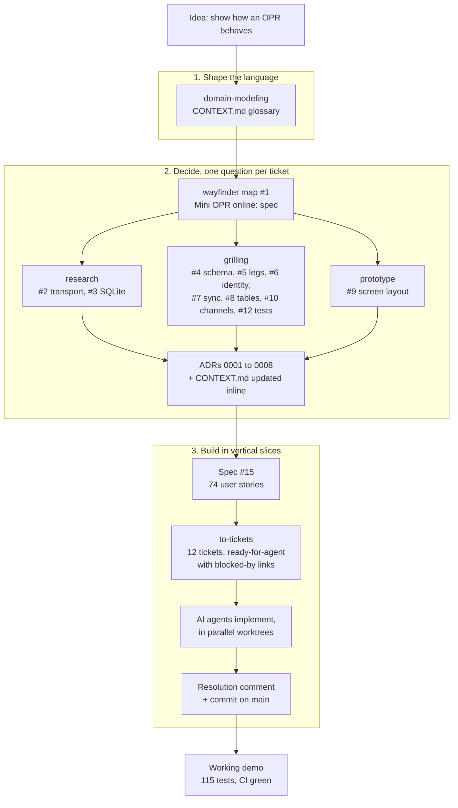

### Which skill did what

| Skill | Used for | Output in the repo |
|---|---|---|
| `domain-modeling` | Agree on words before code: Incident, Transfer leg, Device, Event log, Offset, Coordinator epoch, with "_Avoid_" synonyms | [CONTEXT.md](../CONTEXT.md), [docs/adr/](adr/) |
| `/wayfinder` | One map issue holding the destination, decisions so far, and open fog; each open question becomes a child ticket | Issue #1 with 10 child tickets |
| `research` | Background agents read primary sources on one question each, in their own worktree | ADR 0001 (plain WebSocket), ADR 0002 (`node:sqlite`) |
| `grilling` | The agent asks hard questions one at a time until a decision is sharp (for example: what happens to a late `legCompleted`?) | ADRs 0003 to 0008 |
| `prototype` | A throwaway HTML page with three layouts per page, to decide by reacting instead of debating | Screen layout decision (#9), never merged |
| `/to-tickets` | Cut the spec into thin vertical slices, each with acceptance criteria and native "blocked by" links, labelled `ready-for-agent` | Tickets #16 to #27 under spec #15 |
| `code-review` | Plugin enabled for reviewing changes against the repo's standards and the ticket | `.claude/settings.json` |

Supporting setup that made agents reliable:

- **[CLAUDE.md](../CLAUDE.md)**: conventions (English, no em dash, glossary terms only), and "flag any conflict with an ADR instead of silently overriding it".
- **[docs/agents/](agents/)**: how agents use the issue tracker, triage labels and domain docs, so every session follows the same flow.
- **Triage labels**: `ready-for-agent` means a ticket is specified well enough for an agent to finish it without a human in the loop.

### Agentic build: tickets as a dependency graph

`/to-tickets` cut the spec into 12 thin vertical slices. GitHub's native "blocked by" links make the order explicit, so several agents could pick unblocked tickets at the same time.

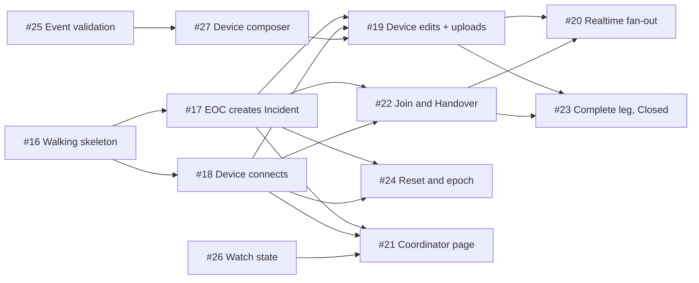

How one ticket goes from spec to done:

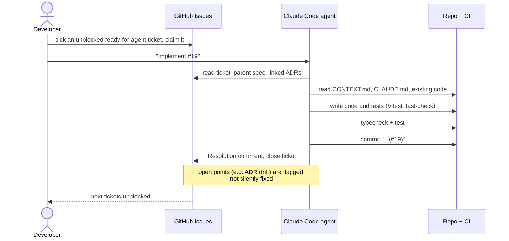

### What made it work

1. **Decide before you build.** Every technical choice was a ticket with a written resolution and an ADR. Agents built against decisions, not guesses.
2. **One vocabulary.** The glossary is loaded into every session through `CLAUDE.md`, so tickets, code and UI all say "Transfer leg", never "trip" or "hop".
3. **Small, independent slices.** Each ticket is end to end and testable on its own, with explicit blockers, so agents run in parallel without stepping on each other.
4. **Tests that prove the hard claims.** "Same result in any order" is checked with `fast-check` property tests; storage tests run on real SQLite in memory; the sync protocol is tested over a real socket.
5. **Humans own the decisions.** People answered the grilling questions and chose between prototype variants; agents did the reading, writing and coding.

---

## 5. Numbers at a glance

| | |
|---|---|
| Time from first commit to working demo | about 4 hours |
| Decision tickets (research, grilling, prototype) | 10 |
| ADRs | 8 |
| Build tickets (vertical slices) | 12 |
| Tests | 115, all passing |
| Product code reused | none |
| Real data | none |
